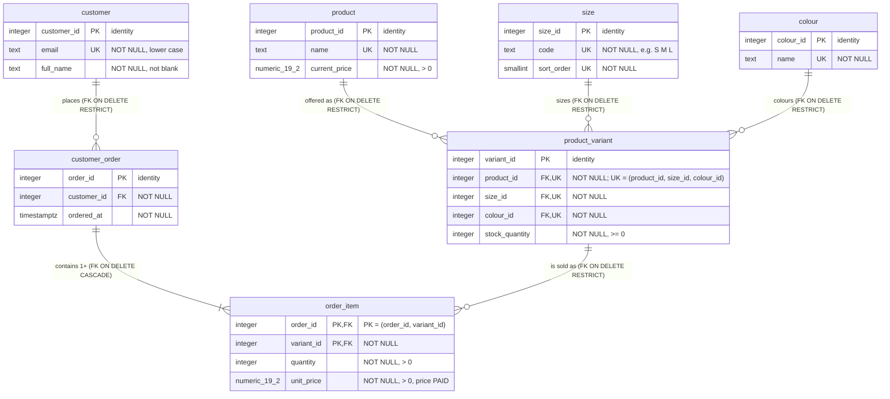

# Entity-relationship diagram: boutique order system

Renders on GitHub (Mermaid). Every table, its primary key (PK), foreign keys (FK), unique keys
(UK), and every relationship with its ON DELETE action. Generated from `sql/01_schema.sql` and
checked against the database catalog (`results/01_catalog_checks.out`).

## Relationships and ON DELETE choices

| Child → parent | Cardinality | Constraint | ON DELETE | Why |
|---|---|---|---|---|
| `customer_order` → `customer` | a customer places 0..n orders; an order has exactly 1 customer | `customer_order_customer_fk` | RESTRICT | Orders are business records; a customer with orders cannot be removed |
| `order_item` → `customer_order` | an order contains **1**..n items | `order_item_order_fk` | CASCADE | Items are part of their order; removing an order removes its lines |
| `order_item` → `product_variant` | an option appears in 0..n order items | `order_item_variant_fk` | RESTRICT | Sold options must remain for order history |
| `product_variant` → `product` | a product has 0..n options | `product_variant_product_fk` | RESTRICT | Catalogue rows in use cannot vanish |
| `product_variant` → `size` | a size is used by 0..n options | `product_variant_size_fk` | RESTRICT | Same |
| `product_variant` → `colour` | a colour is used by 0..n options | `product_variant_colour_fk` | RESTRICT | Same |

"An order has at least one item" (the `|{` end above) cannot be enforced by a foreign key. It is
enforced by the deferred constraint trigger `customer_order_has_items_ck`, which is checked at COMMIT.

## Why this is in third normal form

- **No repeating groups (1NF):** each order line is its own `order_item` row, and each
  size/colour option is its own `product_variant` row. There are no `item1`, `item2`, or
  comma-separated sizes.
- **No partial dependencies (2NF):** in `order_item`, with key (`order_id`, `variant_id`),
  `quantity` and `unit_price` depend on the whole key, meaning *this* option on *this* order.
- **No transitive dependencies (3NF):** product name and price live only in `product`; size codes
  only in `size`; colour names only in `colour`; customer details only in `customer`.
  `product_variant` holds only keys and `stock_quantity`, which depends on the whole option.
- **`order_item.unit_price` is not duplicated data.** It records the price *paid*, a fact about the
  order line. `product.current_price` is today's price. They differ once prices change
  (`sql/04_price_history.sql`).
